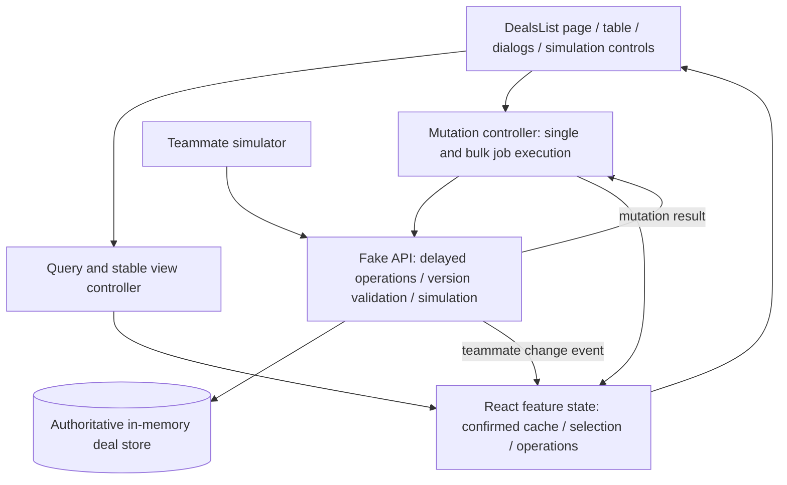

## Current architecture decision: API pagination

This decision supersedes earlier full-dataset client-cache and ordered-result-ID proposals below.

- The fake API owns the entire generated store; React receives no initial dataset.
- `listDeals({query, page, pageSize})` returns `{items, total, page, pageSize}` after backend filtering/sorting/pagination.
- React retains only current-page records, total count, query/pagination, and request feedback. State is not mirrored into deals/query/page/page-size refs; request handlers pass explicit state values and record merges use functional updates.
- Every page navigation fetches again and replaces the previous rows. Query, sort, search, page-size, and Refresh also fetch.
- Manual selections persist across pages as ID/version pairs only; the header affects the current page.
- Single/bulk confirmations merge only visible records. Off-page returned records are discarded; bulk result state keeps metadata only.
- Current-page membership/order stay stable after a save until the next fetch; the refresh banner is the only filter-staleness indicator. Row-level filter mismatch labels and their client calculation have been removed.
- Loading/error/retry paths retain selection appropriately. Superseded responses cannot replace newer results.
- There is no page key or automatic table scroll reset; scrolling is left to the browser when results change.
- No realtime simulator, cross-tab synchronization, polling, or live backend is introduced by this change.

# HighLevel Deals List — HLD & LLD

**Status:** Discovery, single saves and manually selected bulk stage changes across pages implemented. Automatic teammate simulation/live updates remain excluded for now  
**Scope:** React frontend take-home; one screen, simulated backend, 50,000 deals  
**Deadline:** Sunday, November 15, 2026, 11 PM IST  
**Primary source:** SDE 2/3 FE Opportunities Take-Home, pp. 1–2. Supplemental sources: Frontend Assignment – Preparation Pointers, pp. 1–4; Frontend Assignment – Points to be noted, pp. 1–2.

## 1. Requirements and decisions

### Current-time filtering follow-up (November 15, 2026)

Remove reference-time state, its latest-value ref, and the bootstrap time prop. Filtering reads `Date.now()` once per calculation rather than retaining the screen's initial/last-refresh clock. Apply and Refresh recalculate inactivity against current time; the list still does not tick/reorder automatically as time passes. `queryDeals` accepts an optional explicit time only for deterministic tests. The generator's independent test clock remains useful for reproducible mock records.

### API lifecycle cleanup follow-up (November 15, 2026)

Create initial records/reference time and the fake API once at application setup in `main.jsx`, then pass them through `App` to the page. The page uses the returned API object directly. Remove service creation, `apiRef`, and method-wrapper object from `useDealsList`; the hook receives only initial records/time and manages UI state. Test setups inject a fresh API instance per case. Existing latest-value refs in the state hook still coordinate asynchronous state updates; they do not own an API. This supersedes earlier API-ref initialization descriptions below.

### Reducer removal follow-up (November 15, 2026)

The candidate prefers ordinary React state. Remove the reducer implementation and its state folder. `hooks/useDealsList/useDealsList.js` now owns separate useState values and named update functions, with `helpers/dealCache.js`, `helpers/results.js`, and `helpers/selection.js` colocated within that hook folder. Derived page rows/counts remain computed; ordered IDs remain a deliberate stable snapshot. Latest-value refs support same-tick merges and asynchronous refresh completion against the current query without nested state-setter side effects. Cache monotonic versions, immutable selected versions, current-page header behavior, cross-page preservation, query resets and page clamping remain unchanged. Earlier reducer-based designs below are superseded.

### State cleanup follow-up (November 15, 2026)

Remove the combined dataset state. `generateDeals()` now returns only deal records, used directly by the reducer initializer. Owners/owner lookup are static mock-data exports; the page holds the fake API in a stable ref rather than React state. Reference time has one home in the reducer. Remove the redundant initial deal-array state and use a plain success-message string. Visible values/counts remain computed. Ordered IDs remain an intentional query snapshot so confirmed saves do not reorder rows; they cannot be derived continuously from the current cache without changing that behavior.

### Naming and structure follow-up (November 15, 2026)

Constants now live in a responsibility-based `constants/` folder: `stages.js`, `filters.js`, `pagination.js`, `mockData.js`, `time.js`, and `simulation.js`. UI stage definitions no longer contain mock record counts; fixture distributions and names are in mockData. Select options and fake API defaults are imported from their corresponding constants files. Consumers use direct imports.

Components are further grouped by responsibility under `components/table`, `components/filters`, `components/deal-actions`, and `components/bulk-actions`. Table/pagination, query controls, single-deal UI, and bulk UI each have their own folder. Action tests are colocated with the corresponding components; imports reference the new locations directly. Behavior is unchanged.

The screen is named Deals List throughout the application and project documentation. The page entry is `src/pages/deals-list/DealsListPage.jsx`, with `DealsListToolbar`, `createDealsApi`, and `dealsReducer` names for its related components/service/state. Reducer files live in `state`; filtering and sorting helpers live in `utils`. Page-specific UI, data and hooks stay colocated under the page. This naming/organization change does not change application behavior.

### Explicit refresh and filter copy follow-up (November 15, 2026)

Refresh is always available beside the Deals heading, replacing the conditional notice's refresh button. It calls `listDeals()` on the authoritative fake API, merges complete newer records, then rebuilds the current query using the current page/size. Preserve the page where possible and clamp if needed. Successful refresh clears selection and advances the inactivity reference clock; failure retains existing data/selection with a retryable error. Keep rows visible while loading, prevent duplicate reads, and disable stage actions during refresh. Existing bulk result summaries remain intact. The prototype reads the full dataset because filtering/pagination currently live in the frontend; there is no polling or automatic refresh.

Remove the "Changes take effect on Apply" and generic last-customer-activity explanatory text from the filter popover. Keep Apply and retain only the meaningful Won/Lost exclusion note when inactivity is selected. Draft/application behavior is unchanged.

### Filter application follow-up (November 15, 2026)

Owner, stages and inactivity are now draft choices within Filters. Replace Done with Apply: only Apply commits those fields together and rebuilds results, resetting page/selection while preserving page size and sorting. Draft edits leave table values, count, chips, page and selection untouched. Escape, Close, outside click, focus leaving or toggling closed discard drafts; reopening initializes from applied filters. Apply/Close/Escape restore trigger focus. Search debounce, sorting, chip removal and Clear filters retain their existing direct behavior. This supersedes earlier immediate-popover-filter descriptions below.

### Implemented bulk milestone (November 15, 2026)

Latest candidate decisions supersede all earlier bulk-selection/batching proposals below. Select individual rows or use the header checkbox for the current page, with an indeterminate partial state. Follow-up decision: preserve selections when navigating between pages, allowing manual accumulation across pages. The header selects/deselects only its current page; no Select all matching option is exposed. The action bar shows total, current-page and other-page counts. Size, search, filter, sort and explicit-refresh changes clear selection. Selection stores original displayed IDs/versions; later merges do not silently refresh versions.

The bulk modal uses these selected versions without fetching latest records first. Choose a target stage, confirm the total count including other pages/no undo, then send one `bulkUpdateDealStage({ deals, targetStage })` call. It uses one simulated delay, then validates and commits each item independently through the same private helper used by single saves. There is no per-record frontend call, internal chunk worker system, or fabricated incremental progress. Controls/closing are blocked while the request runs; a synchronous guard prevents duplicate submissions. The entire selection clears on confirmation, and the request uses an immutable input snapshot.

When the request settles, close the modal and show cumulative saved/no-op/network-failure/conflict/invalid counts plus unsuccessful deal details above the table. Retry sends only network-failed original inputs; successes/conflicts are never automatically resent. Conflicts merge latest data and require review/new selection. Unresolved results must be reviewed or dismissed before starting a replacement operation. Batch cache merges copy once, ignore older versions, and preserve ordered rows/page/scroll until explicit refresh. The selected count can exceed page size through manual page navigation; selecting thousands still requires explicitly visiting those pages.

The candidate explicitly skipped automatic teammate simulation, rejected polling for now, and deferred live-update architecture. Simulation settings remain code-only. Bulk behavior is independently implemented against the in-app fake API.

### Implemented single-action milestone (November 14, 2026)

Latest candidate decision: every Change stage opening fetches the latest complete deal from the fake API by ID; never initialize the stage picker from the table snapshot. Display loading/error/retry before editing. Save sends ID, target stage and fetched version, retaining confirmed row values until success. The API returns the full saved deal; React merges it by ID only if its version is newer. Modal controls/closing are blocked during save, with a synchronous duplicate-request guard. Success closes the modal and shows a notification; precommit failure preserves the target and allows explicit retry. Conflicts return/merge the latest record and require explicit review before another save against its version.

An isolated in-memory API store owns saved data. Reads/writes simulate configurable 300–1,500 ms delays; saves default to 10% precommit failure. The candidate subsequently requested removal of simulation settings from the UI: configure defaults in `api/createDealsApi.js`, or supply overrides in tests. This supersedes earlier proposals for a simulation panel. A feature-local reducer separates confirmed records from ordered results. Fresh reads/local saves preserve row placement, page and scroll; stale results show a refresh notice and out-of-filter labels. Explicit refresh reapplies the query and clamps the page. No polling, SSE/WebSocket, automatic teammate simulator, or bulk APIs are introduced. This section supersedes the earlier UI-only/disabled-save description below; future bulk/live-update details remain proposals.

### Implemented UI-only stage-change preview (November 14, 2026)

Candidate decision: use a kebab menu in the final table column, containing only Change stage. This opens a modal preselecting the current stage and allowing any stage as a target, including backward moves and reopening closed deals. There is no inline editor or extra confirmation modal. Save remains disabled with an explanation until API behavior is planned. Draft selections do not mutate data; Cancel/Close/Escape discard them and return focus to the row's action button. Reopening starts from the current deal stage. The row menu is portalled outside the table's scroll region to avoid clipping; the modal uses the native dialog top layer. Saving, request lifecycle state, notifications, and API contracts are not implemented or finalized by this UI step.

### Implemented milestone 2: deal discovery (November 14, 2026)

Stage UI follow-up: stages now use a collapsed multi-select dropdown within Filters, with checkbox options and a summary of All stages, one selected name, or the selected count. Matching/chip behavior is unchanged. Escape closes the nested stage dropdown before closing the outer Filters panel.

UI follow-up: Search and Sort by stay visible; Owner, Stages and Inactivity now live in a funnel Filters popover. Changes apply immediately without an Apply step. The active count includes one per selected stage, plus owner/inactivity when set; removable chips show those filters outside the closed panel. Clear filters remains visible. The non-modal panel focuses Owner on opening, supports Escape/Close/Done with trigger focus restoration, and dismisses on outside pointer or focus leaving the filter area. On smaller screens it uses a viewport-constrained floating panel. Filtering/query logic is unchanged by this layout update.

Follow-up: expanded the dummy owner pool from 20 to 30 named owners for filter testing, retaining 50,000 total deals. This is a demo-data adjustment requested by the candidate; the original brief describes a 20-person team.

The approved discovery plan supersedes earlier discovery proposals below. The candidate subsequently removed the redundant My/All Deals dropdown: Owner is the sole ownership control and defaults to All owners. Any named owner can be selected, including Priya. There is no current-user restriction or scope state; earlier My/All references below are superseded. Company/ID search is a trimmed, case-insensitive substring with a 250 ms debounce. Multiple stage checkboxes use OR, with no selection meaning all stages. Different filter categories combine using AND.

Inactivity presets are Any time, 7+, 30+, 60+, and 90+ elapsed days from last customer activity, inclusive at the threshold. Use the screen-initialization reference clock, with no ticking/background changes. Active inactivity filtering excludes Won/Lost and explains this in the UI. Closed-only stages plus inactivity intentionally yields no results.

Sort dropdown options: oldest/newest activity (open before closed), highest/lowest value, company A–Z/Z–A (across all matches); all ties use ID. Filter and sort all records before pagination, memoizing results independently of page and page size. Query changes reset to page one, preserving page size. Clear filters clears search, stages, owner and inactivity while keeping sorting and size. Query state resets on reload. The heading shows matching count; empty results offer Clear filters. Table scroll resets on page/result changes while focus stays with the user's control.

Remain view-only. Review the table and discovery implementation before planning or implementing stage actions or bulk operations.

### Approved milestone 1 (November 14, 2026)

Follow-up implemented: users can choose 25, 50, or 100 rows per page. Default is 50; changing the size returns to page one. The preference is local to the current session and resets on reload.

Implement React with JavaScript/JSX, Vite, plain CSS, and a native semantic table. Show all 50,000 shared deals with 20 owners, 50 rows per page, and Previous/Next navigation. Default ordering is open deals first, oldest activity first within open/closed groups, then ID as tie-breaker. Use local page state; reducer/context is deferred. No follow-up field is needed for this milestone.

Search, filters, My/All scope, custom sorting, selection, editing, the fake API, background simulation, and bulk behavior are deferred. Create only the files used by this milestone. The detailed API/bulk contracts and workflow below are planning proposals for later review, including items previously labelled agreed/confirmed; this milestone does not approve their implementation. The candidate's recorded JavaScript and no-Undo preferences remain, with the supplemental-guide tradeoffs acknowledged.

The sales team has 20 users and 50,000 shared deals, with up to 10,000 deals in some stages. The application must help users identify work, move individual or many deals, tolerate saves with 300–1,500 ms latency and approximately 10% failures, handle teammate edits without disrupting work, and be keyboard accessible. The fake API must expose adjustable simulation controls. The submission is a GitHub repo runnable with one command, a 1–2 page write-up, and a 2–3 minute recording. The brief recommends about six hours and explicitly excludes login, a real backend, extra pages and visual polish.

### Agreed product choices

- My Deals is the default; All Deals is available. Simulate one current salesperson, no authentication.
- Table, not Kanban; meaningful default prioritization plus user-selected filters and sorting.
- Individual/page selection and an explicit action to select every matching deal. Never silently add records to a selection.
- Capture each selected record's ID and version. Fake API rejects stale writes individually; other bulk items can succeed.
- Pessimistic updates: show confirmed stage and immediate pending feedback; display API-confirmed data, not speculative stages.
- Confirm stage changes before issuing mutations. For bulk changes show count, target and no automatic undo warning.
- Retry network failures; conflicts require review and a fresh deliberate action.
- **Undo is explicitly excluded by the candidate.** Supplemental guides repeatedly recommend it. Confirmation mitigates accidental changes but does not provide recovery after a committed mistake; acknowledge this limitation in the write-up. Manual stage changes remain possible, but restoring a mixed-stage bulk operation is not equivalent to undo.

### Confirmed technical choices

React with JavaScript (JSX), not TypeScript. Separate single-stage and bulk-stage API methods; the frontend issues one bulk API call per operation, not one call per record or batch.

### Proposed choices (not yet approved)

Vite, native semantic HTML table, CSS, and 50-row client-side pagination are approved for milestone 1. A feature reducer/context and standalone in-memory fake API remain later proposals. No Redux, UI kit, virtualization, router, real network server or persistence across reloads. The earlier next-follow-up default sort proposal is superseded by oldest activity first, open deals before closed deals. All seven stages appear in milestone 1; filters remain deferred.

## 2. High-level architecture



The fake API owns authoritative data. React owns a separate cache of confirmed records, plus UI-only state. Both run in the browser but the UI must never mutate the API's store directly. A user's request sends IDs, expected versions and intended stage; the API returns results. Teammate changes mutate the authoritative store and notify the UI. The UI maintains a stable ordered view of record IDs independently from the confirmed record values.

**Why pagination:** 50,000 records in memory is manageable for this mock scenario; rendering only 50 rows keeps DOM work bounded and simplifies keyboard focus and selection. No need to introduce virtualization unless profiling reveals a real need. Filtering/sorting happen on the full relevant dataset, not just the current page. Real production would likely use server-side queries and pagination; this assignment intentionally has no backend.

**Why React state:** one screen and one feature. A reducer makes state transitions explicit, testable and explainable. Context can be restricted to controllers or stable dispatch; avoid broad subscriptions for every row. No extra state library unless justified by measurements.

## 3. Data model and contracts

Data contracts expressed as JavaScript JSDoc; implementation may refine naming:

```js
/** @typedef {'NEW_LEAD'|'CONTACTED'|'DEMO_DONE'|'PROPOSAL_SENT'|'NEGOTIATION'|'WON'|'LOST'} Stage */
/** @typedef {{id:string, companyName:string, ownerId:string, stage:Stage, value:number, lastActivityAt:number, nextFollowUpAt:number|null, updatedAt:number, version:number}} Deal */
/** @typedef {{id:string, name:string}} Owner */
/** @typedef {{id:string, expectedVersion:number, targetStage:Stage}} MoveInput */
/** @typedef {{id:string, expectedVersion:number}} SelectionEntry */
// MoveResult: {kind:'success'|'noop', deal} OR
// {kind:'network-error'|'invalid', id, message} OR
// {kind:'conflict', id, latest}.
// SimulationSettings: minLatencyMs, maxLatencyMs, failureRate (0..1),
// teammateEnabled, teammateIntervalMs.
// Query: scope ('mine'|'all'), search, stages (empty = all), ownerId,
// inactiveDays, sort ('followUp'|'value'|'activity'|'company'), direction.
```


Generate exactly 50,000 records and 20 owners deterministically, with realistic stage distributions (include at least one stage with 10,000), mixed deal values, follow-up dates, and stale/fresh activity. Use a fixed seed and a reference clock for predictable tests. Stage changes advance `updatedAt` and `version`; they do not necessarily represent actual customer contact, so leave `lastActivityAt` unchanged unless the simulated business action is a contact. Exclude closed deals from follow-up prioritization and inactive-cleanup eligibility by default when that filter is active; show this clearly. Allow direct stage moves in this demo, including reopening closed deals, with confirmation; no transition rules were specified.

## 4. Fake API LLD

```js
// Public API contract (method signatures shown as comments).
// listDeals() -> Promise<Deal[]>
// updateDealStage({ id, expectedVersion, targetStage }) -> Promise<MoveResult>
// bulkUpdateDealStage({ targetStage, deals }, { onProgress })
//   -> Promise<MoveResult[]>; deals = array of SelectionEntry.
// onProgress receives incremental per-item results and processed/total counts.
// subscribeToTeammates(callback) -> unsubscribe function
// getSettings() -> settings; setSettings(settings) -> void
// simulateTeammateChange(id) -> Deal
```


Implementation: `Map` keyed by deal ID private to the API; return immutable copies or immutable record references, never the mutable map. `listDeals` returns an initial snapshot; fake reads may be immediate (brief specifies save latency, not read latency). Initialize one API instance for the application and subscribe with cleanup; don't recreate data or timers on render. Subscribe before requesting the initial snapshot and merge initial records by version (or start the simulator only after initialization) so a teammate event cannot be lost during initialization. Capture settings for each request at initiation, validate rate and delay range. Teammate simulator runs on an interval only while enabled; manual targeted simulation allows deterministic conflict reproduction. A simulated teammate can change stage or record customer activity (and increment version). Use a clock/random injection for tests.

### Atomic validation

1. Wait a random 300–1,500 ms (adjustable).
2. For each item, find current record, validate input and compare `expectedVersion` to current version. Missing records/invalid stage produce an invalid result. A mismatch returns `conflict` and latest record.
3. Apply simulated failure independently to eligible items (default 10%). Failures occur **before** a commit; this is a deliberate simulation assumption.
4. If eligible, write `{ ...current, stage: targetStage, updatedAt: now, version: current.version + 1 }` and return it. No `await` between version check and write. In a real backend this is a conditional database update/transaction, not simply an in-memory check.
5. Treat target already equal to current as a no-op after version validation; return `noop` with the confirmed deal, avoid version increments and count it as skipped in the operation summary. Prevent obvious no-ops in the UI where possible.

The API exposes one single method and one bulk method, sharing the same private validation/commit helper. The API publishes teammate changes only through the teammate subscription; local writes are reconciled through their returned results. If a teammate update arrives before an older local response, merge only the record with the higher version. Same-version responses are idempotent. This prevents a delayed success from overwriting a newer displayed value. No automated conflict retry with a fresh version.

### Bulk latency and failure semantics

The frontend calls `bulkUpdateDealStage` exactly once for the confirmed selection (or once for a later retry of failed items). The fake API internally processes chunks of 200 with up to four concurrent async workers as a proposed implementation detail, not separate frontend API calls. Both public methods reuse a private per-record validation/commit helper; the bulk method does not call the public single method for every record. Each internal chunk has one simulated latency delay; each item is independently validated and subject to a simulated precommit failure. Report incremental results via `onProgress` after each chunk, with final per-item outcomes returned once the job finishes. Yield between chunks and keep unrelated UI usable. This models one logical bulk job with progress events; a production HTTP API would use a job ID and progress polling or streaming. Chunk size, concurrency and shared latency are simulation assumptions to verify and document. For 3,200 records this is 16 internal chunks; for 50k, 250. No actual network transport or multi-tab synchronization.

## 5. React state and view LLD

```js
// State shape (plain JavaScript objects and Maps).
const initialState = {
  dealsById: new Map(),
  viewIds: [], // ordered snapshot of IDs
  query: { scope: 'mine', search: '', stages: [], ownerId: null,
    inactiveDays: null, sort: 'followUp', direction: 'asc' },
  page: 0,
  pageSize: 50,
  selected: new Map(), // ID -> { id, expectedVersion }
  pendingById: new Map(), // ID -> operation ID
  operation: null, // active or most recent bulk summary
  rowErrors: new Map(),
  viewStale: false,
};
// Operation: id, kind, targetStage, total, processed, succeeded,
// failed, conflicts, skipped, errors (Map keyed by deal ID).
```

Keep single-save pending/errors per ID; bulk summary is independent so a user can operate on another unreserved deal during bulk processing. Allow only one active bulk operation at a time. Reserve all bulk IDs at start, not just currently in-flight IDs, to prevent conflicting local single updates. The controller should acquire these reservations synchronously (e.g. a ref-backed registry mirrored to reducer state), so two rapid clicks cannot both pass a check against a stale React render. Release each as it completes. Store operation inputs separately (immutable snapshot) so UI selection changes cannot change the running request. Keep failed network inputs (ID, expectedVersion, targetStage) so Retry does not accidentally use current versions. A new bulk action may replace the previous summary only after its failures are dismissed/acknowledged; individual row errors remain until resolved or dismissed.

Reducer actions (suggested): `INIT`, `APPLY_QUERY`, `REFRESH_VIEW`, `SET_PAGE`, `SELECT_IDS`, `DESELECT_IDS`, `CLEAR_SELECTION`, `START_OPERATION`, `APPLY_RESULTS`, `MERGE_TEAMMATE`, `DISMISS_ERROR`. Use immutable updates, copy maps once per batch rather than once per item. Use `React.memo` for deal rows with stable record references and callbacks if profiling warrants it. Generate and filter data outside render where practical; debounce search (~250ms) or apply via input submission; no filter/sort on every individual teammate event. Stable tie-breaker ID. Measure before adding memoization. Rendering cost bounded by 50 rows; query recomputation O(n log n) for sorting, and map copies O(n) per batch are an accepted prototype trade-off to profile.

### Stable view and background synchronization

- Query application (filter, scope, sort, or explicit Refresh) builds a sorted snapshot of matching IDs from latest confirmed cache, resets or clamps page. Page navigation slices the existing IDs. Default ordering: open deals with next follow-up earliest first; closed/missing dates last; tie by ID. Other sort choices use direction and deterministic tie-breaks.
- Background updates merge latest record values immediately (only if higher version). Do **not** automatically reorder or remove rows, change the page, or change selection. If membership/order may have changed, show `New changes — Refresh results`. Affected rows that no longer match filters are labelled `No longer matches filters`; don't present stale membership as live. Counts describe the current results snapshot, not a continuously recomputed live count. Explicit refresh applies new membership/order and clears the indicator.
- Local successful moves also update visible record values without unexpected row jumps; if the row no longer matches the filter, keep it visible until explicit refresh with the same label. This is an intentional product proposal for consistent behavior. For explicit refresh, focus the same record if still on page; otherwise focus table heading or next available row and announce result. Page number clamped if result count shrinks.
- Background updates don't affect selection snapshots. Selected rows changed since selection display `Changed since selection` and their original version is retained. If a selected record leaves the view after explicit refresh, retain it by ID and show hidden-selection count; users can clear selection. Scope/filter changes clear selection (with notice) to avoid applying actions to unexpected records; sort and page changes preserve it. Disable stage action for pending IDs. Counts of selected records are explicit, never inferred from current visible rows.

## 6. Component LLD

| Component | Responsibility / contract |
|---|---|
| `DealsListPage` | Feature provider/controller, initializes API/cache, connects query, selection, mutations and simulator. |
| `DealsListToolbar` | Controlled My/All scope, search, stage/owner/inactivity filters, sort controls and Refresh changes button. Emits query changes; no direct API writes. |
| `DealTable` | Semantic table, column headers, current page IDs, selection state and callbacks; empty/loading state. |
| `DealRow` | Confirmed deal values, checkbox, stage action, saving/error/conflict labels; calls `onSelect`, `onRequestMove`, `onRetry`. |
| `Pagination` | Page count, previous/next controls, current page and result count; emits page change. |
| `BulkActionBar` | Selected count, select all matching, clear, target stage, move action; shows hidden/changed selection count. |
| `ConfirmMoveDialog` | Immutable operation preview (count, stage, no-undo warning, stale/pending exclusions); cancel or confirm. No mutation on opening. |
| `OperationSummary` | Progress, success/failure/conflict counts, retry network failures, review conflicting records; never implies all succeeded. |
| `SimulationPanel` | Adjust delay range, failure %, teammate interval/on-off; manual targeted teammate update; settings validation. |

Proposed layout: header/current salesperson; scope and toolbar; selection and operation feedback; paginated table; pagination; collapsible simulation panel. Columns: checkbox, company, stage, owner, deal value, last activity, follow-up, actions/status. No extra pages. Keep loading, empty results and errors meaningful. Use plain CSS and native buttons/selects/inputs.

### Keyboard behavior

Use native table semantics, labels on checkboxes and stage controls, and native buttons/selects. Tab/Shift+Tab reach all interactive elements; Space toggles row selection; Enter activates actions. Implement Arrow Up/Down when a row checkbox has focus to move to adjacent row checkbox on the same page; scroll focused row into view. Do not intercept arrows in select/text inputs. Previous/Next page accessible via buttons; on explicit page navigation keep focus on pagination or move to first row with a clear announcement. Visible focus outline, no mouse-only controls. Native modal dialog with focus trap/initial Cancel focus, Escape closes without commit, restore trigger focus (or table heading if no longer present). Use aria-live for save status, operation progress at batch granularity, errors and refresh notice; avoid announcing every row change. Preserve focus on background events. Add accessible indeterminate header checkbox using DOM `indeterminate` state.

## 7. Workflow LLD

### Single move

1. User selects target stage; capture the displayed record version at intent creation and open confirmation. Existing stage stays visible.
2. Confirm => reserve ID, display `Saving to ...`, call `updateDealStage`. Cancel => no mutation. Prevent repeated same-record operations while pending; other records remain usable.
3. Success => merge returned confirmed record if version is newer, release pending, show success; mark stale view if appropriate. Failure => release pending, retain original input and show Retry. Conflict => merge latest confirmed record, explain that teammate edited it and require a fresh stage-change decision. A later newer teammate update is not overwritten by a delayed response.
4. Retry the exact original input for network errors. If version changed since the initial request, reject as conflict. No automatic retries with newer versions. If user opens a new stage action, use current displayed version and confirm again.

### Bulk selection and move

- Header checkbox toggles only current-page IDs; unchecked header removes current-page selections only. Individual toggles use original displayed version when selected. `Select all N matching deals` snapshots the current filtered ID set and the versions from the confirmed cache at the moment of explicit selection; already selected entries keep their original version. If the view is stale, require explicit refresh before extending to all matching, so the count and membership are accurate. Snapshot is an explicit ID/version map; 50k entries are acceptable for this demo. A newly matching record is never added automatically.
- Stage action opens a confirmation preview: target, selected count, pending/no-op exclusions, known changed records and no automatic undo warning. Keep original ID/version list immutable once preview is opened. If selection includes known changed records, flag them and let the API report conflicts; do not silently refresh versions. If an existing selected record has already reached target at its selected version, skip as no-op; if its version changed, let API reject it rather than hiding a conflict.
- Confirm reserves IDs; call `bulkUpdateDealStage` once with the full selection and target stage. The fake API runs internal chunks of 200 with up to four workers; dispatch one reducer action per progress event. The final result completes the operation without counting incremental results twice. Each record updates independently only on API success. Keep current UI responsive and allow unrelated single moves. An internal chunk-level unexpected failure must release pending IDs and mark those records failed; in the simulator all planned network failures are per-record precommit failures.
- Display processed/total, succeeded, network failed, conflicts and skipped. Retry only failed network inputs; do not resend success or conflict IDs. Preserve original expected versions. Conflict review opens/filters to latest data and requires a new deliberate selection/move; no blind overwrite. Keep selection for failed records or clear completed selection with explicit feedback (proposed: remove successes/skips, retain failed/conflicting entries if selection hasn't changed since operation began). Use selection generation or entry identity to avoid removing a newer selection on completion. Users can clear selection while job continues; completion never re-adds removed entries.
- No Undo. Users may manually perform a new confirmed move, but that will not automatically restore each original stage of a mixed bulk operation.

### Simulation demonstration

Default 10% failure, 300–1,500 ms latency, teammate changes enabled at a proposed 5-second interval (one or a few deals per tick). Panel can set 0% / 100% failure, adjust min/max and pause/change teammate frequency. Manual trigger updates the currently selected or chosen deal by ID, with stage change or customer activity change. This makes a stale selection test reproducible; background random updates alone might never hit the desired record. Optional offline toggle is not essential; 100% failure demonstrates known precommit failures. Real network timeout after a committed request is not simulated, and would need idempotency keys/reconciliation in production.

## 8. Suggested file structure

```text
src/
  main.jsx
  App.jsx
  pages/deals-list/
    constants/
    data/generateDeals.js
    api/createDealsApi.js
    state/dealsReducer.js
    state/queryDeals.js
    state/selection.js
    hooks/useDealsListController.js
    hooks/useBulkMove.js
    components/DealsListPage.jsx
    components/DealsListToolbar.jsx
    components/DealTable.jsx
    components/DealRow.jsx
    components/Pagination.jsx
    components/BulkActionBar.jsx
    components/ConfirmMoveDialog.jsx
    components/OperationSummary.jsx
    components/SimulationPanel.jsx
    deals-list.css
  tests/  (or colocated .test.js files)
    deals listApi.test.js
    selection.test.js
    dealsReducer.test.js
    bulkMove.test.js
README.md
AGENTS.md
```

File boundaries are guidance, not an obligation to create empty abstractions. Combine tiny helpers if that improves readability. Use Vitest for core unit tests (proposed). Browser manual verification plus one automated interaction test if time permits. Build with `npm run build`; dev with `npm run dev` after dependency install; document a one-command setup/run such as `npm install && npm run dev` for a fresh clone. Include actual commands only after they work.

## 9. Acceptance tests and performance evidence

| Scenario | Pass condition |
|---|---|
| 50k data | Exactly 50k records; full dataset accessible; at most 50 deal rows rendered; sort/filter operate on all matches. |
| My Deals | Default current owner; All Deals shows shared records; filters and sort behave correctly. |
| Single save 0% failure | Pending visible, stage unchanged until success, then confirmed stage. |
| Single save 100% failure | No stage change, error visible; set 0% and retry successfully. |
| Concurrent edit | Select/version v, teammate updates to v+1, stale move rejected; latest data preserved. |
| Out-of-order event | Newer teammate version survives older API success arrival. |
| Bulk selection | Header selects page only; explicit all selects full filtered set; paging/sorting preserve selection; scope/filter clear it. |
| Bulk partial failure | Successful records stay committed; retry only failed records; conflict not retried blindly. |
| Bulk quick actions | Pending record cannot be updated again; unrelated record remains editable. |
| Stable view | Teammate update doesn't move focus/page or silently reorder; refresh applies latest query results. |
| Keyboard | Complete select, confirm/cancel, move, retry and page navigation without mouse; visible focus. |
| No undo | Confirmation clearly warns; cancellation makes no API call; manual new move remains possible. |

Use deterministic RNG and injected timers for API tests; use seeded data and explicit teammate trigger. Test selection snapshots, conflict rejection, reducer monotonic merge, bulk counts and retries. Verify performance in production build using browser Performance/React Profiler: initial load, filter/sort 50k, bulk 3,200, scroll, background updates. Record actual timings/observations only; do not claim unmeasured FPS or latency. If Map copy overhead becomes noticeable, optimize batch size or use a more targeted cache update only after profiling.

## 10. Implementation sequence and deadline

Timebox design review (~20–30 min). Start with vertical slice rather than building all visual components first.

1. **Foundation (~45–60 min):** scaffold React/JS/Vite, generator, table, My/All, filters/sort/pagination; verify 50k.
2. **Reliability (~75–90 min):** fake API, version check, simulation controls, single confirmation/pending/error/retry, monotonic merge and stable view.
3. **Bulk (~60–90 min):** explicit selection, snapshot, confirmation, one bulk API call with internal batching, progress, partial results, retry/conflict review.
4. **Accessibility + tests (~60–90 min):** keyboard/focus, deterministic tests, build, performance check, fix bugs.
5. **Deliverables (~45–60 min):** README, 1–2 page write-up, 2–3 min recording; check repository access and clean setup.

These are estimates, not guarantees. The brief's six-hour target is the scope constraint; reserve separate learning/review and contingency time if needed. Target core completion Saturday night and submission Sunday evening (before 11 PM). Avoid additional features until critical scenarios pass.

## 11. Open questions / design review

- React + JavaScript confirmed. Review Vite, native table, pagination and reducer.
- Resolved for milestone 1: oldest activity first, open deals before closed deals; no follow-up field.
- Approve explicit refresh for stable membership/order and live cell updates? Trade-off: visible rows/counts may temporarily be out of filter; clear labels mitigate this.
- Separate single and bulk API methods confirmed. Review internal chunk settings (200 records, four concurrent workers) and no persistence on refresh? Both are documented simulation choices.
- Confirm no Undo despite supplemental review guidance; this is already the candidate's explicit choice and should not be reopened unless they choose to.

## 12. Codex instructions (copy to AGENTS.md)

- Read this design and the original assignment. Implement one approved milestone at a time. Do not add libraries or change core product decisions without explaining the trade-off first.
- Preserve authoritative fake API vs UI cache separation. Use atomic version validation, immutable selection snapshots, pessimistic updates and monotonic record merge.
- Do not implement Undo, login, real backend, extra pages or decorative features. Include explicit confirmation before stage changes.
- After each milestone, explain files changed, data flow and failure cases; run applicable tests/lint/build; show evidence and remaining limitations. Do not claim unimplemented features.
- Use simple readable JavaScript with JSDoc where useful, meaningful names, semantic HTML and stable keyboard focus. Keep the candidate able to explain every major choice.
